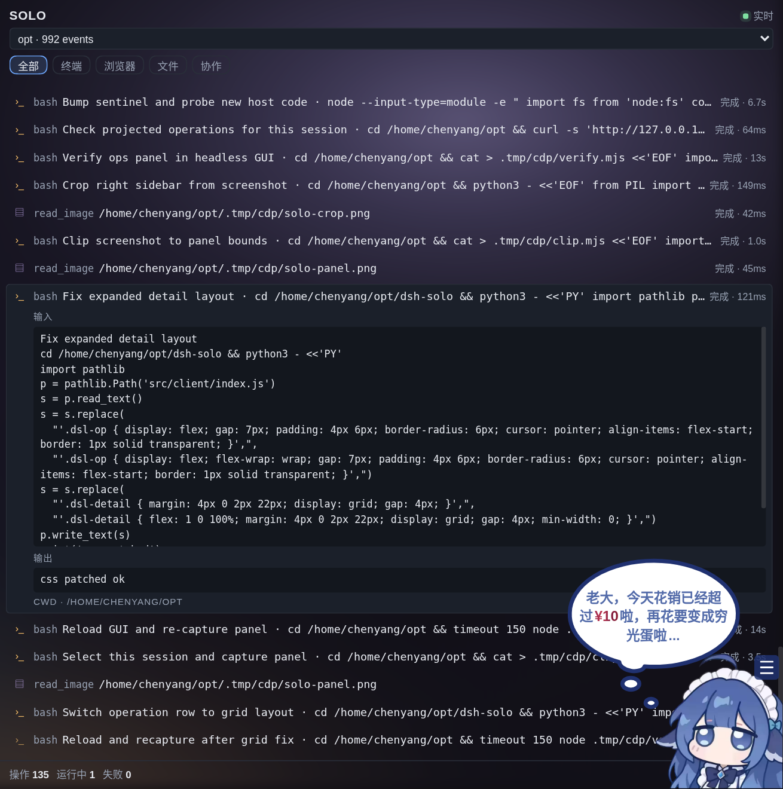

# dsh-solo

把 agent 的**操作本身**摆到右栏：每一次工具调用（终端命令、浏览器动作、文件读写、子代理协作）实时出现一行，
带状态、耗时、完整输入与输出。点击任意一行展开它真正跑的命令和真正拿到的结果。

不是待办清单，也不是 agent 的自述：面板里的每一行都由宿主从**会话日志**的 `tool/call` + `tool/result`
折叠而来。行变绿，是因为日志里真的来了对应的 result 事件；命令还在跑，它就一直脉冲。



## 为什么这样做

「可视化完成操作」的关键不是界面长什么样，而是**数据从哪来**。让 agent 自己上报「这一步完成了」，
你看到的永远是转述；而 session log 是 append-only 的事实记录，agent 改不了它。所以这个面板只读日志：

```
session.snapshotEvents()  ──projectOps()──▶  [{name, kind, summary, status, durationMs, result, cwd}]
        ▲                                              │
        └──── 不可伪造（agent 只往里追加事件）───────────┘
```

## 装

```bash
dsh plugin --profile web add github:stcn52/dsh-solo
```

本地开发直接软链，然后 bump profile `cordis.patch.yml` 末尾的 `# reload` 哨兵让宿主重读插件行：

```bash
ln -s /home/chenyang/opt/dsh-solo ~/.dsh/profiles/web/node_modules/dsh-solo
```

验证：

```bash
curl -s http://127.0.0.1:3080/solo/version          # {"version":"0.2.0"}
curl -s http://127.0.0.1:3080/solo/sessions         # 活跃会话 + 事件数
curl -s 'http://127.0.0.1:3080/solo/ops?max=10'     # 最近 10 次工具调用
```

宿主代码改动**不需要重启**：`cordis.patch.yml` 的哨兵一改，插件行重载，新的 `/solo/*` 立即可用。

## 面板

- **会话选择**：下拉列出所有活跃会话（目录 + 事件数），默认最近活跃的那个。跨会话查看别的 agent 在干什么。
- **筛选**：全部 / 终端 / 浏览器 / 文件 / 协作。
- **操作行**：`glyph · 工具名 · 参数摘要 · 状态与耗时`。`进行中` 脉冲，`失败` 红色。
- **展开**：完整输入（命令/参数）、完整输出（终端 stdout+stderr、文件操作结果、错误）、cwd。
- **跟随**：默认贴底跟随最新；向上滚动即停住，回到底部自动恢复。
- 轮询 900ms 拉一次日志投影，最多保留 150 条操作。

## 路由

```
GET /solo/sessions            活跃会话（id、cwd、事件数、最后活动时间）
GET /solo/ops?sessionId=&max= 该会话的操作投影（默认 120 条，最新保留）
GET /solo/version             宿主实际加载的插件版本
```

只读：面板永远不能替你执行任何东西，也就没有「面板点了什么导致 agent 做了什么」这条歧路。

## 投影规则

- `tool/call` 建一行，状态 `running`；`tool/result` 按 `callId` 收口，记录 `durationMs` 与 `status`。
- 只有 result 没有 call（窗口截断/中途接入）：单独成行，不吞掉活动。
- 参数摘要按工具语义取：`bash` → description + command；`browser_*` → 动作 + url/target；
  `read/write/edit` → 路径；`glob/grep` → pattern + 范围；其余取最有信息量的字段，兜底才是原始 JSON。
- 结果与输入都有字符上限（列表 280 / 展开 6000），超长标记 `已截断`；不把整份日志塞进浏览器。
- 纯函数 `src/core/ops.js` 不碰时钟/网络/文件系统，测试全压在它身上（12 例）。

## 已知边界

- **不是执行器**：面板不发命令、不点浏览器。要操作就在对话里让 agent 做，面板负责把它做的每一步摊开。
- **浏览器动作只是"调用记录"**：`browser_*` 行显示 URL/选择器与返回结果，不是实时画面。实时画面属于
  `dsh-builtin-browser` 自己的窗口（本机当前缺 Electron 运行时，那套工具起不来）。
- **终端输出以 result 为准**：运行中的长命令，面板显示"进行中"，输出在命令结束后落入日志。
  要边跑边看流式输出，用 `dsh-cmd-live` 的「命令」页签——两者互补，不互相替代。
- **权限模式不是本插件管的**：真实的人在环门禁由 DSH 的 permission preset（approval: ask）负责，
  这里不做一个假装能拦住 agent 的开关。
