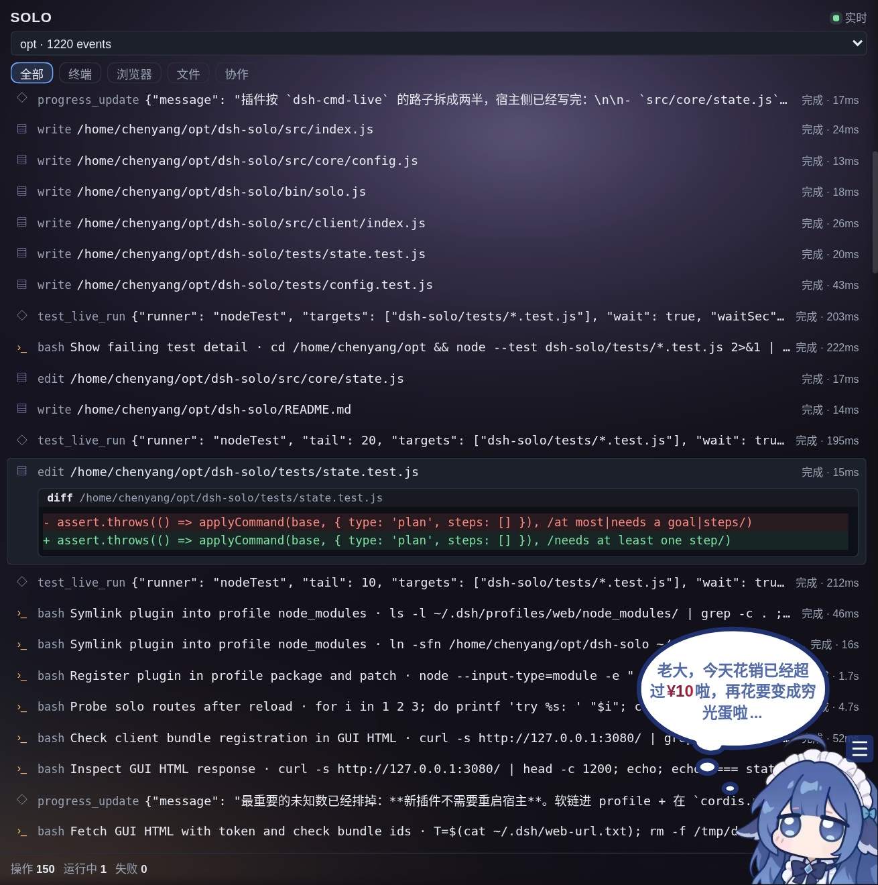
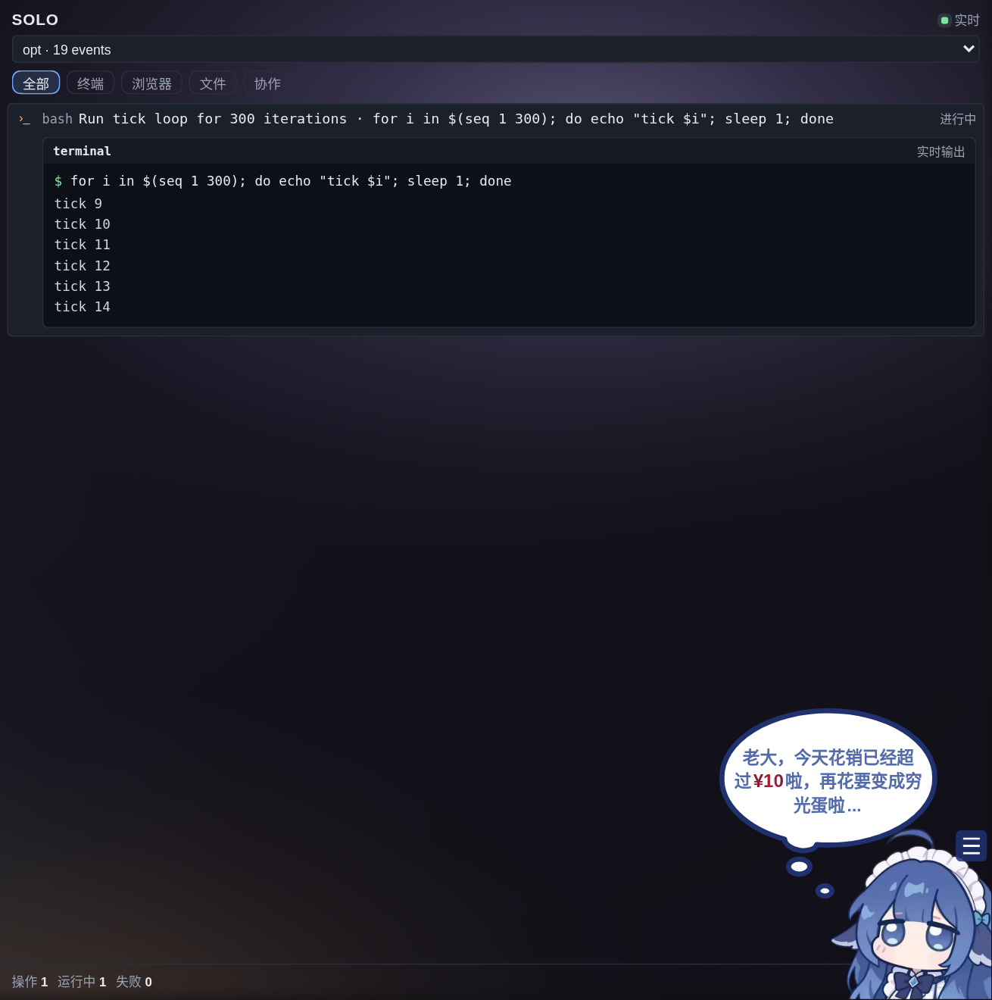
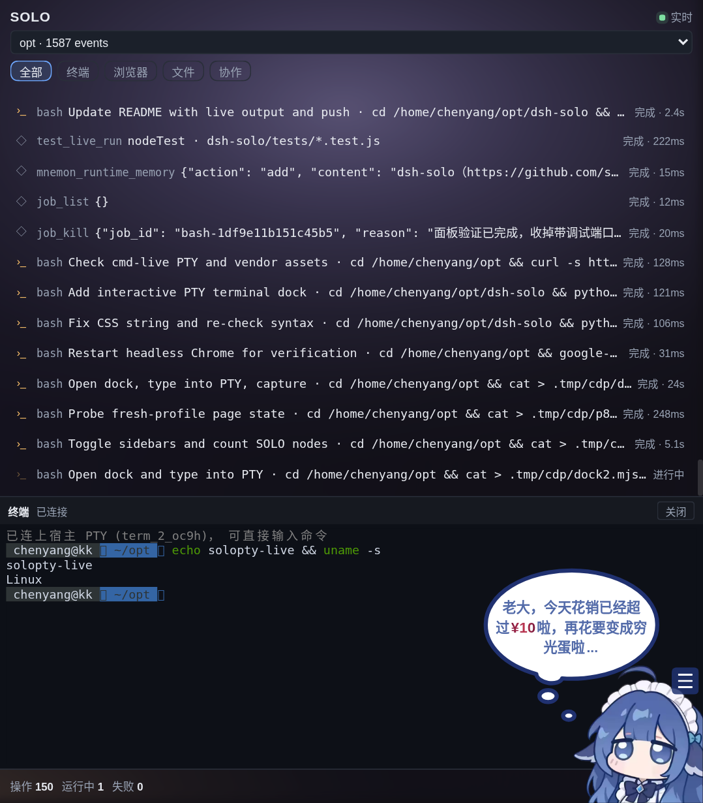

# dsh-solo

把 agent 的**操作本身**摆到右栏：每一次工具调用（终端命令、浏览器动作、文件读写、子代理协作）实时出现一行，
带状态、耗时、完整输入与输出。点击任意一行展开它真正跑的命令和真正拿到的结果。

不是待办清单，也不是 agent 的自述：面板里的每一行都由宿主从**会话日志**的 `tool/call` + `tool/result`
折叠而来。行变绿，是因为日志里真的来了对应的 result 事件；命令还在跑，它就一直脉冲。








## 为什么这样做

「可视化完成操作」的关键不是界面长什么样，而是**数据从哪来**。让 agent 自己上报「这一步完成了」，
你看到的永远是转述；而 session log 是 append-only 的事实记录，agent 改不了它。所以这个面板只读日志：

```
session.snapshotEvents()  ──projectOps()──▶  [{name, kind, summary, status, durationMs, result, cwd}]
        ▲                                              │
        └──── 不可伪造（agent 只往里追加事件）───────────┘
```

## 装

```bash
dsh plugin --profile web add github:stcn52/dsh-solo
```

本地开发直接软链，然后 bump profile `cordis.patch.yml` 末尾的 `# reload` 哨兵让宿主重读插件行：

```bash
ln -s /home/chenyang/opt/dsh-solo ~/.dsh/profiles/web/node_modules/dsh-solo
```

验证：

```bash
curl -s http://127.0.0.1:3080/solo/version          # {"version":"0.2.0"}
curl -s http://127.0.0.1:3080/solo/sessions         # 活跃会话 + 事件数
curl -s 'http://127.0.0.1:3080/solo/ops?max=10'     # 最近 10 次工具调用
```

宿主代码改动**不需要重启**：`cordis.patch.yml` 的哨兵一改，插件行重载，新的 `/solo/*` 立即可用。

## 面板：按「人操作时看到的样子」渲染

时间线仍是操作列表，但**点开任何一行，看到的是当时那个界面**，不是字段转储：

| 操作类型 | 展开后是 | 长什么样 |
| --- | --- | --- |
| `bash` / `pwsh` / `run_code` | 终端窗格 | 顶部 `terminal <cwd>` 与状态，正文 `$ 命令` + 输出；**命令还在跑时就是实时流**（见下），结束后以日志里的最终输出为准 |
| `edit` | diff 窗格 | `diff <path>`，删除行红底、新增行绿底，原样对照 old/new |
| `write` | 编辑器窗格 | `editor <path>`，行号栏 + 写入的正文 |
| `read` | 只读窗格 | 文件路径与读到的内容 |
| `browser_*` | 浏览器窗格 | 地址栏显示该动作真正作用的 URL，右侧是动作名；下面是返回文本或明确的「没有画面可显示」 |
| 其他工具 | 原始窗格 | 输入 / 输出，超长标注截断 |

顶部还有会话下拉（目录 + 事件数）、类型筛选（全部/终端/浏览器/文件/协作）与实时指示；底部是操作数与
运行中/失败计数。默认贴底跟随最新，向上滚动即停住。

## 路由

```
GET /solo/sessions            活跃会话（id、cwd、事件数、最后活动时间）
GET /solo/ops?sessionId=&max= 该会话的操作投影（默认 120 条，最新保留）
GET /solo/version             宿主实际加载的插件版本
```

只读：面板永远不能替你执行任何东西，也就没有「面板点了什么导致 agent 做了什么」这条歧路。

## 实时输出（PTY 那一半）

会话日志只会在命令**结束时**才有一条 `tool/result`，所以光靠日志，运行中的终端窗格只能显示「进行中」。
面板因此同时订阅 `dsh-cmd-live` 的 `/cmd-live/stream`（它包装了 `ctx.shell`，是真正拿着流的那一方）：

- 两侧没有共享 id，匹配靠「命令文本重合 + 启动时间窗口（10s）+ 运行中优先」；
- 命中后把 `output` 事件的行直接写进终端窗格，带闪烁光标、自动贴底、每命令最多保留 400 行；
- 命令结束后仍以日志里的完整输出为准（日志是权威，流只是提前量）；
- `dsh-cmd-live` 不在时 SSE 失败一次即放弃，页脚显示「实时输出 · 关」，面板退回只看结束后的输出。

## 自己动手：面板里的可输入终端

底部「打开终端」会向宿主申请一个真 PTY（`POST /cmd-live/term/create`），xterm 用 `dsh-cmd-live` 自带的
`/cmd-live/vendor/*`（同源，不往客户端 bundle 里再塞一份），输入走 `/term/input`、尺寸走 `/term/resize`、
输出走 `/term/stream` 的 SSE。收起或换页即 `POST /term/close`，PTY 随宿主进程结束。

这是**你自己的终端**，不是 agent 正在跑的那条命令——「看它做」和「自己上手」并排放在同一个面板里，
互不干扰。`dsh-cmd-live` 缺席时按钮禁用并给出原因。

## 投影规则

- `tool/call` 建一行，状态 `running`；`tool/result` 按 `callId` 收口，记录 `durationMs` 与 `status`。
- 只有 result 没有 call（窗口截断/中途接入）：单独成行，不吞掉活动。
- 参数摘要按工具语义取：`bash` → description + command；`browser_*` → 动作 + url/target；
  `read/write/edit` → 路径；`glob/grep` → pattern + 范围；其余取最有信息量的字段，兜底才是原始 JSON。
- 结果与输入都有字符上限（列表 280 / 展开 6000），超长标记 `已截断`；不把整份日志塞进浏览器。
- 纯函数 `src/core/ops.js` 不碰时钟/网络/文件系统，测试全压在它身上（19 例）。

## 已知边界

- **对 agent 的操作只读，对自己的终端可写**：操作流是事实记录，改不了；可输入终端只作用于你自己新开的 PTY。
- **浏览器只有地址栏，没有像素**：日志里没有页面截图（图片以 attachment 引用存放，不随事件走），所以浏览器窗格
  显示它作用的 URL 与返回文本。真要像素，得接 `dsh-builtin-browser` 的截图通道；本机那套工具目前起不来
  （缺 Electron 运行时、宿主无 DISPLAY）。
- **实时输出依赖 dsh-cmd-live**：它没装或没启用时，终端窗格只显示命令结束后的输出；页脚会标「实时输出 · 关」。
- **权限模式不是本插件管的**：真实的人在环门禁由 DSH 的 permission preset（approval: ask）负责，
  这里不做一个假装能拦住 agent 的开关。
